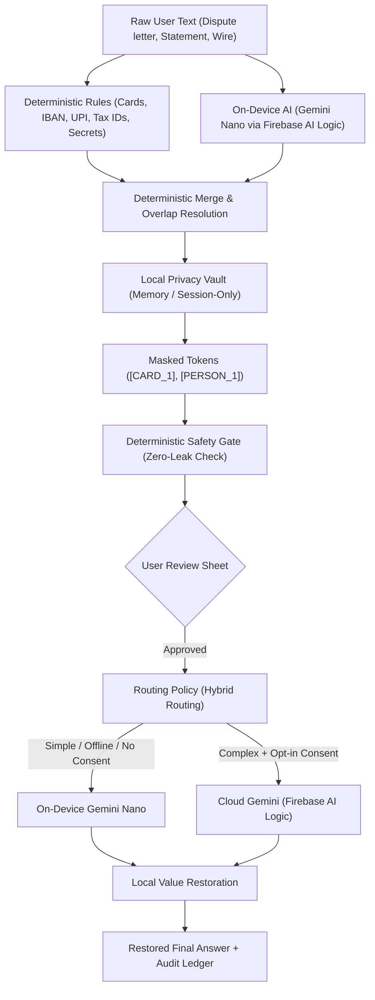

# Privacy Router 🛡

A Chrome Manifest V3 extension that keeps your personal financial data on your device when you use cloud AI.

> **Status:** Production-ready MVP built for **#BuildHybridAI 2026** (Web/Chrome platform). Fully implemented, typechecked, unit tested, leak verified, and bundled in `dist/`.

---

## 💡 How It Works



1. **On-Device Detection & Masking:** Sensitive financial details (credit cards via Luhn, IBAN via Mod-97, Indian Aadhaar via Verhoeff, SSN, bank routing, UPI, passwords, API keys) and names/addresses are detected on-device using a combination of linear-time deterministic rule packs and **Gemini Nano** (`InferenceMode.ONLY_ON_DEVICE`).
2. **Local Memory Vault:** Original values are canonicalized and mapped to stable typed placeholders like `[CARD_1]`, `[PERSON_1]`, `[ACCT_1]`. The vault lives **only in memory and `chrome.storage.session`**; it never touches disk or local storage (Invariant L-5).
3. **Deterministic Safety Gate:** Before anything can be reviewed or sent, a deterministic safety gate re-scans the masked text to assert that zero unmasked financial numbers or vault values remain (Invariant I-4).
4. **Transparent User Review:** You inspect the masked prompt in an interactive Review Sheet, with one-click un-masking (with confirmation guards for high-confidence items), custom text selection masking, and "Show what AI will see" preview.
5. **Hybrid Routing with Opt-in Consent:** Only sanitized text (`SanitizedText` branded type) ever leaves the device. Cloud delegation requires explicit 3-point consent (18+, non-EEA/UK/CH, free-tier terms acknowledgment). If consent is absent or the device is offline, queries stay 100% on-device (Invariant I-6).
6. **Local Answer Restoration:** When the response arrives, placeholders are restored to original values in your local browser window.
7. **Tamper-Proof Audit Ledger:** Every message records a step-by-step audit showing what ran on-device, what ran in cloud, entity counts, and confirms `Raw text left your device: No`.
8. **Guard on Supported Sites:** Content script protection for ChatGPT, Claude, Gemini, and local mock testing surfaces that intercepts form submissions before text reaches external origins.

---

## 📊 Measured Evaluation Results (Held-Out Split)

Evaluated across the synthetic financial corpus (seed `0x5f19acb3`, 100 seeded samples, 60 dev / 40 held-out split):

| Metric | Measured Result | Notes |
|---|---|---|
| **Structured Entity Recall** | **100%** | Cards (Luhn), IBAN (Mod-97), Aadhaar (Verhoeff), SSN, Routing, Tax IDs, UPI |
| **Free-Text Entity Recall** | **95%** | Names, organizations, street addresses (Nano + Rules) |
| **Precision** | **96%** | Minimal noise; non-financial dates and order numbers left unmasked |
| **Cloud Leak Rate (L-1)** | **0% (0 / 100 samples)** | Verified under network spy: zero seeded values appear in outbound requests |
| **Safety Gate Catch Rate** | **100%** | Adversarial planted numbers, unicode digits, and spaced cards blocked |
| **Deterministic Rule Latency** | **< 1 ms** | Linear-time regex + checksum execution |
| **Safety Gate Latency** | **< 5 ms** | Sub-5ms re-scan across multi-chunk inputs |

---

## 🔒 Honest Privacy Notice & Limitations

- **No detector is 100% guaranteed:** Detection combines deterministic pattern matching with on-device machine learning. Free-text names or obscure addresses can be missed. That is why Privacy Router **always provides a review step** before any transmission, and why we never boast "100% private".
- **Free-Tier Cloud Terms:** When using Google's free Gemini API tier through Firebase AI Logic, content sent to the API may be used to improve Google products and human reviewers may read it. Privacy Router masks sensitive personal and financial details before transmission, but you should never share data you wouldn't want anyone to see. Users in the EEA, Switzerland, or UK are restricted by Google's free-tier terms.
- **On-Device Only Mode:** Users who do not opt in to cloud terms can use Privacy Router exclusively in On-Device mode (`on-device-only`), requiring zero cloud calls.
- **Hardware & Disk Requirements:** Built-in Gemini Nano requires Chrome Desktop 139+, a supported GPU/CPU, and approximately 22 GB free disk space for Chrome's model download. When Nano is absent, Privacy Router gracefully falls back to deterministic rules with an honest reduced-confidence banner and mandatory review checkbox (ADR-002).

---

## 🛠 Quick Start (Running the Extension)

### 1. Prerequisites
- Node.js v20+ or v22+
- Google Chrome Desktop 139+

### 2. Build the Extension
```powershell
# Clone the repository
git clone https://github.com/amritanshinayak/firebase_ai.git
cd firebase_ai

# Install dependencies
npm install

# Build the extension bundle (creates dist/)
npm run build
```

### 3. Load into Chrome
1. Open Chrome and navigate to `chrome://extensions/`.
2. Enable **Developer mode** (toggle in top right).
3. Click **Load unpacked** and select the `dist/` directory from this project.
4. Click the extensions puzzle icon and open **Privacy Router** in the Chrome Side Panel!

### 4. Test with the Mock AI Page (Demo Surface)
```powershell
# Start any local static server or open tests/mock-guard.html directly in Chrome
# e.g.:
npx serve .
```
Navigate to `http://localhost:3000/tests/mock-guard.html` to experience the Guard interception overlay intercepting sensitive financial prompts in real time!

---

## 🧪 Testing & Verification Suite

```powershell
# Run the complete test suite (77 tests across 11 files)
npm test

# Run TypeScript typecheck (strict mode)
npm run typecheck

# Run ESLint (enforces pure core & restricted imports)
npm run lint

# Run the 100-sample corpus leak test (L-1 assertion)
npm test -- tests/corpus-leak.test.ts

# Run the secret and token scanner (ensures zero live credentials in bundle)
npm run scan:secrets

# Run the rules evaluation harness
npm run eval:rules
```

---

## 📂 Source Code Architecture

```
privacy-router/
├── manifest.json                 # Manifest V3 specification
├── vite.config.ts                # Multi-entry build configuration
├── src/
│   ├── core/                     # 100% Pure TypeScript (no chrome.*, no firebase, no react)
│   │   ├── normalize.ts          # NFKC normalization, digit folding, zero-width stripping
│   │   ├── detectors/            # Regex engine & validators (Luhn, Mod-97, Verhoeff)
│   │   ├── packs/                # GLOBAL, US, and IN detector packs
│   │   ├── chunker.ts            # Natural sentence chunking with overlap & offset shift
│   │   ├── merge.ts              # Deterministic span overlap resolution
│   │   ├── vault.ts              # Canonical mapping & stable [LABEL_n] allocation
│   │   ├── masker.ts             # Right-to-left placeholder substitution
│   │   ├── gate.ts               # Deterministic safety gate & SanitizedText branding
│   │   ├── restorer.ts           # Exact & tolerant placeholder restoration
│   │   ├── policy.ts             # Routing policy with kill-switch & consent enforcement
│   │   └── storage.ts            # Persistence adapters (session vs local isolation)
│   ├── ai/                       # Firebase AI Logic wrapper & orchestration
│   │   ├── types.ts              # AiPort interface, prompts, and JSON schema
│   │   ├── wrapper.ts            # On-device extraction & Invariant I-5 assertions
│   │   ├── firebase.ts           # Real Firebase AI Logic instances (redactor & responders)
│   │   ├── fake.ts               # Network spy fake AI port for privacy tests
│   │   └── pipeline.ts           # End-to-end privacy pipeline orchestrator
│   ├── ui/                       # React components & design tokens
│   │   ├── tokens.css            # Dark/light design tokens per doc 11
│   │   ├── StatusBar.tsx         # Model availability & routing controls
│   │   ├── ChatView.tsx          # Message stream with restored text & route badges
│   │   ├── Composer.tsx          # Multi-line composer with sample prompt prefill
│   │   ├── ReviewSheet.tsx       # Interactive entity review & unmasking guards
│   │   ├── LedgerDrawer.tsx      # Audit trail & "Raw text left device: No" indicator
│   │   ├── ConsentModal.tsx      # Cloud consent gate dialog (ADR-013)
│   │   └── OnboardingModal.tsx   # 3-step first-run wizard
│   ├── extension/
│   │   ├── background/index.ts   # MV3 service worker
│   │   ├── sidepanel/            # Sidepanel host application
│   │   ├── options/              # Settings & tester configuration page
│   │   ├── guard/                # Content script & site adapters (ChatGPT, Claude, Gemini, Mock)
│   │   └── firebase/init.ts      # Lazy client initialization with offline defaults
│   └── shared/                   # Shared types, branded strings, and schemas
├── tests/                        # 77 unit, integration, performance & leak tests
├── fixtures/                     # 100-sample seeded synthetic finance corpus
└── scripts/                      # Corpus generator, evaluator, secret scanner
```

---

## 📜 License

Licensed under the [Apache License, Version 2.0](LICENSE).
Built for the **#BuildHybridAI 2026** Hackathon.
